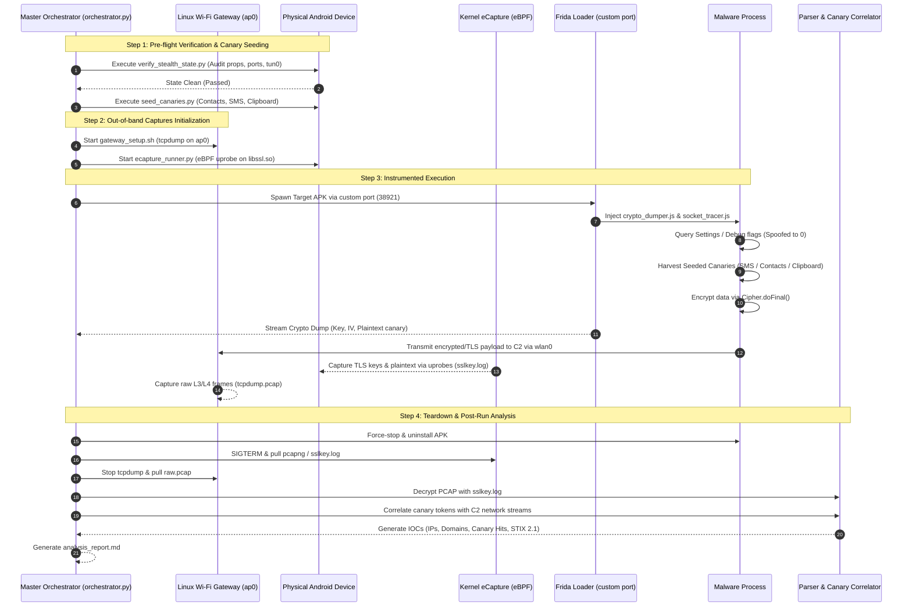

# `task-init.md`: Android Dynamic Malware Analysis Sandbox & Threat Intelligence Toolkit

## 1. Executive Summary & Defensive Operational Mandate

### 1.1 Mission & Threat Context
This project implements an automated, modular, and stealthy Android Dynamic Malware Analysis Sandbox and Threat Intelligence Toolkit designed to observe evasive **Android Infostealers** (e.g., Ermac, Hook, CraxsRAT, SpyNote, Godfather, Medusa, Octo) in an isolated hardware lab environment.

Modern infostealers implement aggressive anti-analysis, anti-debugging, and network-evasion heuristics:
- **System Telemetry Probing:** Inspecting `adb_enabled`, `development_settings_enabled`, `ro.debuggable`, `ro.secure`, and `sys.usb.state`.
- **Debugger & Hook Detection:** Polling `TracerPid` in `/proc/self/status`, inspecting `/proc/self/maps` for Frida/Xposed artifacts, and scanning TCP ports (e.g., `27042`, `5555`).
- **Network Environment Fingerprinting:** Checking active interfaces for VPN (`tun0`, `ppp0`), checking system properties for HTTP proxies (`http.proxyHost`), and enforcing TLS certificate pinning.
- **Data Obfuscation / Pre-Encryption:** Encrypting stolen SMS OTPs, credentials, and crypto seed phrases using AES/RC4/XOR before dispatching them over TLS or raw TCP sockets.

### 1.2 Defensive Objective
The objective of this sandbox is to:
1. **Maintain full automation and monitoring capabilities** while presenting a completely stock, un-debugged production Android OS state to user-space applications.
2. **Capture 100% of out-of-band network traffic and decrypted TLS payloads** without installing custom user CA certificates, without modifying Android proxy settings, and without instantiating VPN interfaces.
3. **Seed trackable synthetic canary data** (fake OTPs, crypto seed phrases, mock banking tokens, contacts, clipboard strings) to prove actual data theft.
4. **Intercept application-layer crypto operations** prior to network transmission.
5. **Correlate observed memory exfiltration with destination C2 endpoints** to automatically output actionable threat intelligence (IOCs, C2 domains/IPs, Telegram bot tokens, STIX 2.1 bundles, and executive Markdown reports).

---

## 2. Sandbox Architecture & Topology

```
+-----------------------------------------------------------------------------------+
|                            HOST WORKSTATION (Linux/macOS)                        |
|                                                                                   |
|  +-----------------------------------------------------------------------------+  |
|  |                     Master Orchestrator (orchestrator.py)                   |  |
|  |  - Session Lifecycle Management        - Artifact Pull & Workspace Archiving|  |
|  |  - Canary Seed Controller               - Correlation & IOC Engine Trigger  |  |
|  +-----------------------------------------------------------------------------+  |
|        |                                 |                             |          |
|        | (ADB Control)                   | (Out-of-band Capture)       | (IPC)    |
|        v                                 v                             v          |
+--------|---------------------------------|-----------------------------|----------+
         |                                 |                             |
         |        +------------------------+                             |
         |        |                                                      |
+--------v--------v-----------------------------------+   +--------------v----------+
|       ISOLATED WI-FI GATEWAY (Linux host / ap0)      |   |  FRIDA HOST CONTROLLER  |
|                                                     |   |  - Custom Port (38921)  |
|  - hostapd Access Point (ap0)                       |   |  - Non-default Binary   |
|  - dnsmasq (Isolated DHCP + DNS logging)            |   |  - Crypto Dumper Stream |
|  - iptables (NAT / Transparent Redirection)         |   |  - Socket Tracer Stream |
|  - tcpdump raw L3/L4 packet capture (.pcap)         |   +-------------------------+
+-------------------------^---------------------------+
                          | (802.11 Wi-Fi Traffic)
+-------------------------|---------------------------------------------------------+
|                         |  PHYSICAL LAB DEVICE (Rooted Android 12-14, ARM64)      |
|                         |                                                         |
|  +----------------------v------------------------------------------------------+  |
|  | Network Interface: wlan0 (DHCP via ap0 gateway, no proxy, no tun0)           |  |
|  +-----------------------------------------------------------------------------+  |
|  | Kernel Layer:                                                               |  |
|  |   - eBPF uprobes on /apex/com.android.conscrypt/lib64/libssl.so via eCapture |  |
|  |   - Emits TLS master secrets (sslkey.log) and decrypted .pcapng out-of-band |  |
|  +-----------------------------------------------------------------------------+  |
|  | Android System Layer:                                                       |  |
|  |   - Magisk / KernelSU resetprop: ro.debuggable=0, sys.usb.state=mtp         |  |
|  |   - LSPosed HideDevMode: Settings.Global spoofing for system_server         |  |
|  |   - Seeded Canary Data: Contacts, Mock SMS, Synthetic Clipboard             |  |
|  +-----------------------------------------------------------------------------+  |
|  | User-Space Sandbox Process:                                                 |  |
|  |   - Target Malware APK (isolated, unprivileged)                             |  |
|  |   - Minimal in-process instrumentation: Cipher.doFinal, socket connect      |  |
|  +-----------------------------------------------------------------------------+  |
+-----------------------------------------------------------------------------------+
```

---

## 3. Phased Implementation Roadmap

### Phase 1: Configuration & Canary Data Seeding (`config/`)
**Goal:** Establish declarative lab configuration and plant trackable, high-entropy synthetic data ("canary credentials") across core Android data providers so that exfiltration can be immediately identified.

- **Step 1.1: `config/lab_config.yaml`**
  - Declarative configuration file specifying:
    - ADB Device Serial / IP connection string.
    - Network interface mappings: physical device Wi-Fi (`wlan0`), gateway access point (`ap0`), upstream egress interface (`eth0`).
    - Tooling paths: static `ecapture` ARM64 binary path on device (`/data/local/tmp/ecapture`), custom frida-server path and port (`38921`).
    - Analysis timeouts, sample APK staging paths, artifact storage directories.
- **Step 1.2: `config/mock_canaries.json`**
  - High-entropy synthetic test records designed for zero false positives:
    - `crypto_wallets`: Seed phrases (12/24 words), private keys (0x...), dummy Bitcoin/Ethereum addresses.
    - `banking_otp`: Realistic 6-digit and 8-digit transactional OTP codes with distinct transaction IDs.
    - `session_credentials`: Mock OAuth refresh tokens, session cookies, fake login passwords.
    - `contacts`: Synthetic phone book entries with distinctive names, numbers (+1-555-CANARY-01), and mock email addresses.
    - `clipboard`: Canary strings mimicking credit card numbers and cryptocurrency deposit addresses.
- **Step 1.3: `config/seed_canaries.py`**
  - Host-side Python automation utility that executes via ADB:
    - Injects contacts via Android `content insert --uri content://contacts/people/`.
    - Injects SMS messages into Android telephony provider (`content://sms/inbox`).
    - Populates the Android system clipboard with high-entropy canary tokens.
    - Verifies canary presence before launching malware analysis.
    - Includes a `--clean` flag to purge seeded canaries during post-analysis teardown.

---

### Phase 2: On-Device Stealth Cloaking (`device_cloaking/`)
**Goal:** Maintain live ADB automation while masking all developer, USB, and debugging flags from user-space applications without injecting intrusive hooks into the malware process.

- **Step 2.1: `device_cloaking/apply_stealth_props.sh`**
  - Root shell script executed on the device via Magisk/KernelSU `resetprop`:
    - `resetprop ro.debuggable 0`
    - `resetprop ro.secure 1`
    - `resetprop sys.usb.state mtp`
    - `resetprop sys.usb.config mtp`
    - `resetprop persist.sys.usb.config mtp`
    - `resetprop init.svc.adbd stopped` (or masked while preserving active daemon socket)
    - `resetprop ro.build.type user`
    - `resetprop ro.build.tags release-keys`
  - Restores properties cleanly when provided `--restore` flag.
- **Step 2.2: `device_cloaking/check_dev_mode.sh` & System Server Cloaking Verification**
  - Validates that `Settings.Global.getInt("adb_enabled")` and `"development_settings_enabled"` return `0` when queried by unprivileged apps.
  - Verifies that LSPosed `HideDevMode` (or custom Xposed hook targeting `system_server`'s `SettingsProvider`) is active, ensuring the setting is spoofed at the IPC layer rather than requiring in-process hooks in the malware.
- **Step 2.3: `device_cloaking/verify_stealth_state.py`**
  - Host-side pre-flight assertion script running an automated audit prior to malware detonation:
    - Asserts that default Frida server port `27042` is closed.
    - Asserts that `tun0`, `ppp0`, or any VPN network interface is absent.
    - Asserts that `http.proxyHost` and `http.proxyPort` system properties are empty.
    - Queries `getprop` across all target properties to confirm expected values.
    - Verifies ADB responsiveness despite masked property values.
    - Returns non-zero exit code if any analysis fingerprint is detected.

---

### Phase 3: Zero-Footprint Network & TLS Interception (`network_capture/`)
**Goal:** Capture 100% of network traffic (DNS, raw TCP/UDP, and plaintext TLS) without setting an Android system proxy, without VPN interfaces, and without trusting custom CA certificates.

- **Step 3.1: `network_capture/gateway_setup.sh`**
  - Bash automation for the isolated Linux host / router:
    - Configures Wi-Fi Access Point interface (`ap0`) via `hostapd` and `dnsmasq`.
    - Enables IPv4 packet forwarding (`net.ipv4.ip_forward=1`).
    - Configures `iptables` NAT masquerade for outbound traffic.
    - Launches background `tcpdump` on `ap0` capturing full packet payloads (`-s 0 -w raw_traffic.pcap`).
    - Logs all DNS queries separately for rapid domain triage.
    - Includes a `--teardown` mode to cleanly flush iptables rules and stop services.
- **Step 3.2: `network_capture/ecapture_runner.py`**
  - Host Python manager for on-device eBPF capture:
    - Deploys and manages the static ARM64 `ecapture` binary in `/data/local/tmp/`.
    - Executes `ecapture tls -m pcap -i wlan0 --pcapfile /data/local/tmp/tls_decrypted.pcapng --sslkeylog /data/local/tmp/sslkey.log --libssl /apex/com.android.conscrypt/lib64/libssl.so`.
    - Attaches eBPF uprobes directly to Conscrypt's `libssl.so` at the Linux kernel level.
    - Operates completely out-of-process: zero byte patching in the malware address space.
- **Step 3.3: Graceful Teardown & Capture Manager**
  - Process signal management (SIGINT, SIGTERM) ensuring eBPF buffers and pcap files are cleanly synced and closed.
  - Automates pulling `raw_traffic.pcap`, `tls_decrypted.pcapng`, and `sslkey.log` back to the host session directory.
  - Cleans temporary files from `/data/local/tmp/` on the Android device.
- **Step 3.4 (Auxiliary): `network_capture/sinkhole_inetsim.conf`**
  - Optional INetSim / mock DNS sinkhole configuration to safely simulate C2 responses in fully severed offline environments.

---

### Phase 4: Dynamic Runtime & Pre-Network Crypto Instrumentation (`instrumentation/`)
**Goal:** Capture pre-encryption payloads (AES, DES, RC4, XOR) before data is encrypted and passed to TLS, and trace native raw socket connections.

- **Step 4.1: `instrumentation/agent/bypass_antidebug.js`**
  - Fallback in-process Frida agent script for samples with aggressive internal checks:
    - Intercepts Java `android.provider.Settings.Global.getInt()`.
    - Intercepts `android.os.Debug.isDebuggerConnected()` and `waitingForDebugger()`.
    - Hooks libc `__system_property_get` to intercept native property reads.
    - Overrides `open()`/`read()` on `/proc/self/status` to mask `TracerPid: 0`.
- **Step 4.2: `instrumentation/agent/crypto_dumper.js`**
  - Deep cryptographic inspection agent:
    - Hooks `javax.crypto.Cipher.init(int opmode, Key key, AlgorithmParameterSpec params)`.
    - Hooks `javax.crypto.Cipher.doFinal(byte[] input)`.
    - Extracts operation mode (ENCRYPT_MODE vs DECRYPT_MODE), algorithm name, secret key hex, IV hex.
    - Emits structured JSON events via `send()` containing raw plaintext buffers, ciphertext buffers, and call stack origins.
- **Step 4.3: `instrumentation/agent/socket_tracer.js`**
  - Low-level network activity tracer:
    - Hooks Java `java.net.InetAddress.getByName` and `getAllByName`.
    - Hooks `java.net.URL.<init>` and `java.net.HttpURLConnection`.
    - Hooks native `libc.so` `connect()`, `send()`, and `sendto()`.
    - Catches custom binary protocols, raw socket C2 beacons, and DGA domains that bypass Java frameworks.
- **Step 4.4: `instrumentation/frida_loader.py`**
  - Python host loader executing Frida with anti-detection precautions:
    - Connects to Frida on a randomized, non-standard TCP port (e.g., `38921`).
    - Uses renamed Frida server binary (`hl_daemon`).
    - Spawns the target package cleanly using `device.spawn()`.
    - Injects consolidated agent scripts (`bypass_antidebug.js`, `crypto_dumper.js`, `socket_tracer.js`).
    - Streams all JSON IPC events asynchronously to a timestamped session file (`instrumentation_events.jsonl`).

---

### Phase 5: Traffic Decryption, Canary Correlation & IOC Reporting (`parser_correlator/` & `orchestrator.py`)
**Goal:** Automatically correlate stolen mock data from crypto dumps with decrypted network streams, identify exfiltration destinations, and produce structured threat intelligence.

- **Step 5.1: `parser_correlator/pcap_decryptor.py`**
  - Integrates `tshark` / `pyshark` with the eCapture `sslkey.log`:
    - Merges raw gateway PCAP with TLS master keys.
    - Decrypts TLS sessions into cleartext HTTP/1.1 and HTTP/2 flows.
    - Extracts HTTP requests, headers, POST bodies, and response payloads into structured JSON streams.
- **Step 5.2: `parser_correlator/canary_hunter.py`**
  - High-precision correlation engine:
    - Ingests `config/mock_canaries.json`.
    - Scans both Frida `Cipher.doFinal` buffers and decrypted network payloads.
    - Detects plaintext and encoded forms (Base64, URL-encoded, Hex).
    - Pinpoints exact timestamp, exfiltration channel, destination IP, port, and URL where canary data was transmitted.
- **Step 5.3: `parser_correlator/ioc_extractor.py`**
  - Automated threat intelligence extractor:
    - Gathers contacted remote IPs, domains, resolved DNS queries, full HTTP POST endpoints.
    - Extracts detected Telegram Bot tokens, chat IDs, Discord webhooks, or hardcoded C2 patterns.
    - Formats output into:
      1. Machine-readable JSON summary (`iocs.json`).
      2. STIX 2.1 Threat Report (`threat_report_stix21.json`).
- **Step 5.4: `orchestrator.py` (Master Workflow Runner)**
  - Unified CLI command: `python3 orchestrator.py --apk <path_to_apk> --duration 120 --config config/lab_config.yaml`
  - Automated execution pipeline:
    1. **Pre-flight Check:** Run `verify_stealth_state.py`.
    2. **Canary Seeding:** Run `seed_canaries.py`.
    3. **Start Captures:** Launch `gateway_setup.sh` (tcpdump) and `ecapture_runner.py` (eBPF).
    4. **Launch Malware:** Launch sample via `frida_loader.py` with instrumentation agents.
    5. **Observe:** Run for specified duration with live console telemetry.
    6. **Teardown:** Terminate malware process, flush and pull capture files, reset cloaking, clean canary data.
    7. **Post-Processing:** Run `pcap_decryptor.py`, `canary_hunter.py`, and `ioc_extractor.py`.
    8. **Report Generation:** Output comprehensive Markdown executive report and JSON/STIX IOC bundles.

---

## 4. Execution Sequence Diagram



---

## 5. Technical Specifications & Dependencies

### Host Machine (Linux/macOS)
- **Python:** 3.10+
  - Dependencies: `pyyaml`, `frida`, `frida-tools`, `pyshark`, `tshark`, `cryptography`, `rich`
- **System Tools:** `adb`, `tcpdump`, `tshark` (Wireshark 4.0+), `hostapd`, `dnsmasq`, `iptables`
- **Network Hardware:** Dedicated secondary Wi-Fi adapter capable of AP mode (e.g., Atheros / Realtek supporting `nl80211` for `ap0`).

### Target Android Device
- **Hardware:** Physical ARM64 Android device (Pixel 4/5/6/7 or equivalent test device).
- **Firmware:** Stock Android 12, 13, or 14 (Userdebug or User build).
- **Kernel:** Linux Kernel 5.4+ with eBPF and uprobes enabled (`CONFIG_BPF=y`, `CONFIG_BPF_SYSCALL=y`, `CONFIG_UPROBES=y`).
- **Root Environment:** Magisk v26+, KernelSU v0.6+, or APatch with `resetprop` binary available.
- **System Modifications:** LSPosed Zygisk framework with `HideDevMode` enabled, or equivalent `system_server` Binder hook.
- **eCapture:** Pre-compiled static ARM64 binary of `ecapture` (version 0.8.0+) placed in `/data/local/tmp/ecapture`.

---

## 6. Verification & Quality Gates per Phase

| Phase | Milestone / Deliverable | Verification Criteria |
| :--- | :--- | :--- |
| **Phase 1** | `config/lab_config.yaml`<br>`config/mock_canaries.json`<br>`config/seed_canaries.py` | 1. Script runs via ADB and seeds contacts, SMS, and clipboard.<br>2. Verifies data via `content query`.<br>3. `--clean` successfully purges synthetic records. |
| **Phase 2** | `device_cloaking/apply_stealth_props.sh`<br>`device_cloaking/verify_stealth_state.py` | 1. `verify_stealth_state.py` passes all checks.<br>2. `ro.debuggable=0`, `sys.usb.state=mtp`.<br>3. `Settings.Global.getInt("adb_enabled")` returns `0`.<br>4. No `tun0`, no proxy properties, port `27042` closed. |
| **Phase 3** | `network_capture/gateway_setup.sh`<br>`network_capture/ecapture_runner.py` | 1. Gateway routes traffic for physical device with zero drops.<br>2. eCapture captures TLS master secrets on test HTTPS request.<br>3. Graceful teardown pulls `.pcapng` and `sslkey.log` without corruption. |
| **Phase 4** | `instrumentation/agent/*.js`<br>`instrumentation/frida_loader.py` | 1. Spawns test app on non-default port.<br>2. Dumps `Cipher.doFinal()` keys, IVs, and plaintext.<br>3. Captures raw native `connect()` and DNS lookups.<br>4. Telemetry logs correctly to `.jsonl`. |
| **Phase 5** | `parser_correlator/*.py`<br>`orchestrator.py` | 1. PCAP decrypts with eCapture `sslkey.log`.<br>2. Canary strings are correctly matched to destination C2 IP/URL.<br>3. Automated end-to-end execution generates valid Markdown report and JSON/STIX IOCs. |

---

## 7. Current Project Status
- Plan created and documented in [task-init.md](file:///Users/puredent/Desktop/dbug/task-init.md).
- Directory structure initialized.
- Standing by for instruction to begin **Phase 1: Configuration & Canary Data Seeding**.
